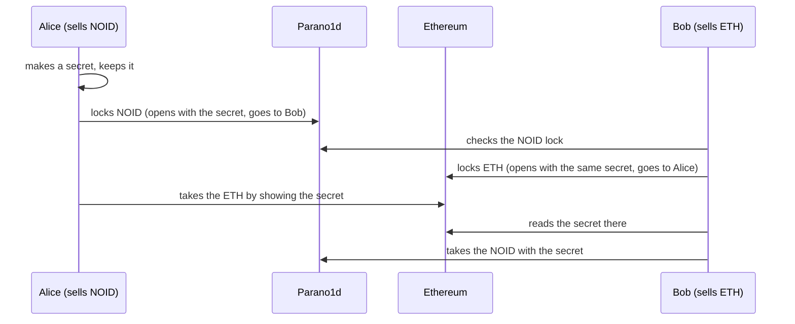

# How No1d Swap works

No1d Swap is a desktop program for Windows and Mac. Two people use it to swap **NOID** (the coin of Parano1d) for **ETH** on
Ethereum mainnet. There is no bridge, no custodian, no pool and no wrapped token. A contract on each chain holds the coins, and
no one can move them but the two people in the swap. Either both sides settle, or both people get their own coins back after a
deadline. It is for two people who have a reason to trust each other, and for small amounts.

## The idea in one picture

Alice sells NOID. Bob sells ETH.

Four words, once each:

- **Secret.** A random number that only Alice knows when the swap starts.
- **Hash-time lock.** A lock on coins with two ways out. Before a deadline it opens for whoever shows the secret. After the
  deadline the coins go back to the person who put them in. The same secret opens the lock on both chains.
- **Reveal.** The moment Alice shows the secret, in the transaction where she takes the ETH. From then on the secret is
  public, and that is how Bob can take the NOID.
- **Deadline.** The point after which a lock gives the coins back. Every lock has one, so nothing is stuck forever.

## Why the NOID seller always goes first

On Parano1d a coin is spent with a zero-knowledge proof: you prove that you know the secret without showing it. So a NOID claim
never reveals the secret. The reveal can only happen on Ethereum, and only the person who holds the secret at the start can
make it. That person has to be the NOID seller. She makes the secret, locks first with the longer deadline, and takes the ETH
last of her two steps. Bob locks second with the shorter deadline and takes the NOID last. The order of the deadlines is what
keeps each side safe. The full design is in [`protocol-design.md`](protocol-design.md).

## What can go wrong, and what happens then

The times are about, for Ethereum mainnet. They count from when the swap is made (Alice presses Prepare) unless said otherwise.
The deadline on Parano1d is about 738 blocks after the swap is made, about 6 hours. Alice's reveal window on Ethereum is 7,200
seconds (2 hours) after Bob locks.

| What happens | What each side gets back, and when |
|---|---|
| **Either side stops before any lock.** | Nothing is locked on Ethereum, so Bob loses nothing. If Alice already funded, her NOID comes back after the deadline, about 6 h 45 min after Prepare. She pays network fees. |
| **Bob never locks.** | Same as above. Alice waits for the deadline and takes her NOID back. Bob has risked nothing. |
| **Alice never reveals.** | Bob refunds his ETH once the 2-hour window is over, about 2 h 20 min after his lock (this includes the wait for Ethereum to make his lock final). Alice takes her NOID back after the deadline. The secret was never shown, so neither side can take the other's coins. |
| **Alice reveals too late.** | Her program refuses to reveal in the last 30 minutes of the window, because a late reveal could publish the secret without paying her. This becomes the case above. |
| **Bob is late to take the NOID.** | **This is Bob's loss.** After the reveal his program has at least about 75 minutes to take the NOID. If it misses that, Alice takes the NOID back at the deadline and keeps the ETH. |
| **A program is closed mid-swap.** | The deadlines run on the chains whether or not the program is open, and the program keeps the computer awake while coins sit in a contract. If you quit and reopen it, it continues from its saved state. Bob's computer must be on and online in the 75 minutes after the reveal. Keep the recovery code the program shows at the first start. |

If a swap stops, ETH can stay locked about 2 h 20 min and NOID about 6 h 45 min before they come back. A swap that goes well
takes about 50 minutes from the funding.

## The one limit that matters today

Parano1d is mined by few producers, and one of them can make more than half of the blocks. If that producer is Alice, she can
reveal the secret, take Bob's ETH, then keep Bob's NOID claim from becoming final until the deadline, and take the NOID back
too. A longer window does not protect Bob against a majority miner. Only Bob is exposed to this. Alice is not.

So Bob's program checks it before he locks. It reads from the chain's own block headers who produced the last 24 hours and the
last 6 hours of blocks:

- **Above 35 % in either window:** the program asks Bob to accept the share in his approval. He is told the measured number.
- **Above 65 % in either window: nobody can waive it.** The swap cannot start, and the page refuses Bob's approval.

While one producer is above 65 %, swaps cannot start. The screen reopens on its own once the producer's share is back at or
under 65 % in both windows. Recent readings have been above it.

Between 35 % and 65 % the screen is not a defence either. It cannot see a miner who uses many addresses, and a share can
rise after Bob locks. Sell ETH only to someone you have a reason to trust. The measurement and the model are in
[`miner-concentration.md`](miner-concentration.md), the screen in [`bob-concentration-gate.md`](bob-concentration-gate.md).

## Live contracts

| Network | Contract | Address |
|---|---|---|
| Ethereum mainnet | the swap's Ethereum lock (`HTLCPoseidonV2`) | [`0x4e364cC86EdBF307CC6F336F3a72e1a24d284D70`](https://etherscan.io/address/0x4e364cC86EdBF307CC6F336F3a72e1a24d284D70) |
| Ethereum Sepolia (test network) | the same code | [`0x48Ce4D6cf3c175737532017e82B9261b51F8E5eF`](https://sepolia.etherscan.io/address/0x48Ce4D6cf3c175737532017e82B9261b51F8E5eF) |
| Parano1d | no shared contract: each swap makes its own lock, built from [`htlc.pruv`](../parano1d/contracts/htlc.pruv) | the program rebuilds it byte for byte before anything is locked |

The code hash of the Ethereum contract, on both networks, is
`0xf510d2a368c730339fa7cf5e023bcf2429d5732793f043e03025780bb7043ff3`. The contract has no owner, no admin key, no pause, no
upgrade and no fee.

**How to check it yourself.** The mainnet contract's source is verified on Sourcify: look the address up at
[repo.sourcify.dev](https://repo.sourcify.dev/1/0x4e364cC86EdBF307CC6F336F3a72e1a24d284D70) and compare it with
[`eth/contracts/HTLCPoseidonV2.sol`](../eth/contracts/HTLCPoseidonV2.sol). For the hash, ask any Ethereum node for the code at
the address (`eth_getCode`) and take its keccak-256: it must equal the code hash above. The program does this check itself and
refuses a contract with other code.

## Caps and fees

- **Caps per swap:** at most **0.5 ETH and 2,500 NOID**. The program refuses more.
- **Smallest swap:** **5 NOID**. The contract's fee limit for a close is at least 50,000 micro-NOID and may not exceed 1 % of
  the amount, so a smaller swap is refused.
- **Ethereum gas.** Bob pays for the lock and, if the swap stops, the refund. Alice pays for the reveal. Measured gas: about
  584,000 for the lock, 689,000 for the reveal, 159,000 for a refund. The program never sends above the fee cap you set (the
  default is 1 gwei).
- **Parano1d fees.** A close of the NOID contract costs at least 5,800 micro-NOID, paid from the locked NOID, so the receiver
  gets that much less than the amount. Alice's funding payment has its own small fee. The program shows all of this, the rate
  and the worst case before the first click.
- **No fee to the project.** Nobody takes a cut.

## What it is not

It is not an exchange. There is no order book, no account and no one holding your coins. The program does not set a price: you
and the other person agree on it elsewhere. There is no outside audit yet: every review so far was made by the project itself,
and the hash function behind the NOID lock has not been reviewed by a cryptographer for this use. Keep amounts small. On
Ethereum mainnet, the swap tool and its helpers settled one swap; the desktop program itself has run on the Sepolia test
network. Parano1d has no test network, so NOID is real money in every swap.

## Next

- Install: the README section [Get it](../README.md#get-it), including how to check an installer before you open it.
- Limits, rules and how to report a problem: [`SECURITY.md`](../SECURITY.md).
