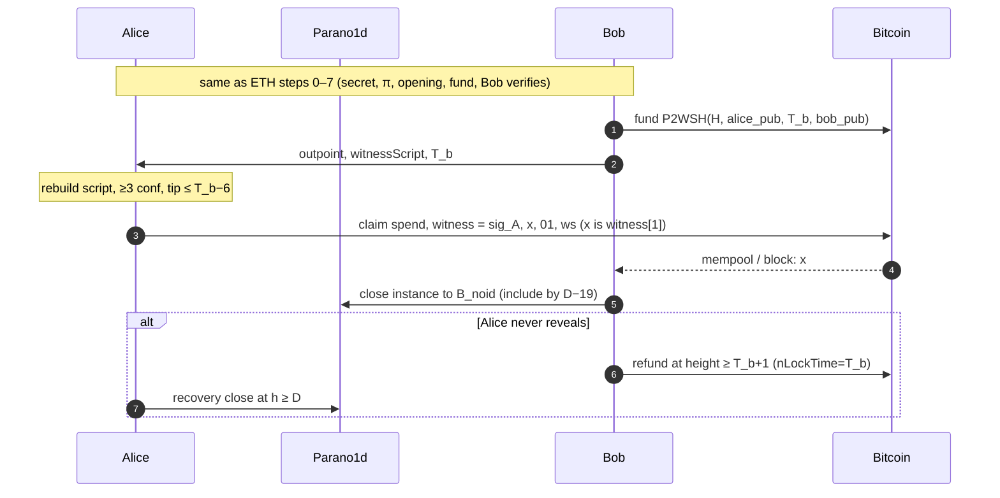

# Bridge-free atomic swaps: Parano1d (NOID) ↔ Ethereum / Bitcoin — protocol design v1

Status: design for implementation. Unaudited. Target: small-amount mainnet trials.
Live runs: twelve logged so far, numbered 1 to 13 (there is no run 7 log). The first was on 2026-11-04 (raw variant, 10 NOID on mainnet against 0.001 ETH on a local Hardhat chain, settled on both legs); the first against Ethereum mainnet was run 8 on 2026-11-06. Measurements in §9.3; logs in `docs/live-run-*.md`. The timing parameters changed since the first run: see §9.1.
Ground truth: `docs/parano1d-capabilities.md` (the "report", vendored Parano1d at
commit `d29b801`) and `eth/contracts/HTLC.sol` + `eth/README.md`. Paths in brackets
are relative to `~/noid-swap/`. Anything not established by those sources
is marked **UNKNOWN** and routed to §9.2 (open questions).

Source checks I repeated for this design, beyond the report:
- mempool eviction rule `noid_mempool/src/contracts.rs:L92-L113`;
- no-salt opening root `noid_tx/src/experimental_object.rs:L96-L129`;
- `build_call(input, output_slot, fee, epoch_anchor, height, terminal)` (L226-L244);
- wallet import resets `active_index = 0` and hex-decodes 64 chars with no `0x` (`noid_node/src/wallet/state.rs:L617-L645`);
- `Derive` (`noid_node/src/wallet/keystore.rs:L69-L93`);
- the slot-conflict admission check, with no replacement path found (`noid_mempool/src/pool.rs:L1296-L1350`);
- the portable `soft_clmul` fallback (`noid_core/src/hardware.rs:L458-L485, L592`);
- the RPCs `getEpochAnchor`, `getSlotHints`, `estimateFeeDetailed` ("includes the current relay floor") (`vendor/parano1d/docs/reference/rpc.md:L118-L147`).

---

## 0. Notation and encoding conventions (normative)

| Symbol | Meaning | Encoding |
|---|---|---|
| `s` | swap secret, the raw path | exactly 32 bytes from a CSPRNG. `s[0]` is the first byte everywhere. |
| `m` | swap secret, the stock-wallet path (a **throwaway** wallet master) | 32 bytes, as for `s` |
| `x` | "the preimage": `s` or `m`, depending on the variant | the bytes revealed on the counter-chain |
| `H` | `SHA-256(x)` over the 32 raw bytes | `bytes32`, digest byte 0 most significant (as in `eth/README.md`) |
| `A` | Parano1d claim authority | 32-byte `Address`, `o1…` when displayed |
| `Addr(x)` | `P([le128(x[0..16]), le128(x[16..32]), L<<64, L])[0..2]`, with `L = u64_be("ADDRFIX_") = 0x414444524649585F` and P = Poseidon2b (t=4, x^7, 8 full + 58 partial rounds) | output is lane0‖lane1, each 16 LE bytes (report §10) |
| `Derive(m,i)` | Poseidon2b sponge with IV 0, absorbing `le128(m[0..16]), le128(m[16..32]), i as u128, 0x6E6F69642D64657269`, padded `finalize`: 3 permutations | 32 bytes, fed to `Addr` as `s` |
| `V` | NOID funded into the lock | u64 μNOID |
| `F_max` | the opening's `max_fee_micronoid` | u64 μNOID |
| `D` (≡ `T_parano1d`) | the opening's `deadline_height`. Claim is valid iff inclusion height `h < D`; refund iff `h ≥ D` | u64 |
| `T_reveal` | counter-chain reveal deadline. ETH: the `timelock` Unix timestamp. BTC: the CLTV height `T_b` | s / blocks |
| `τ_nom`, `τ_fast` | Parano1d block interval: nominal 30 s; planning-fast 20 s | s |

Cross-chain byte rules:
- ETH `claim(lockId, preimage)` takes `preimage = 0x‖hex(x)`.
- The Parano1d stock import reads `hex(x)`, which is the same 64 characters **without** the `0x` prefix (`state.rs:L623-L633` rejects anything other than exactly 64 hex characters after stripping whitespace).

Test vectors. M0 must reproduce all of them before anything is funded:

| Input | Output |
|---|---|
| `x = 00…00` (32 zero bytes) | `SHA-256 = 66687aadf862bd776c8fc18b8e9f8e20089714856ee233b3902a591d0d5f2925` (eth README) |
| `x = 000102…1f` | `SHA-256 = 630dcd2966c4336691125448bbb25b4ff412a49c732db2c8abc1b8581bd710dd` |
| `x = 000102…1f` | `Addr(x) = f8183db204ffb765c7015d851c1754e4974c675b975c6738d9f6d138eb7212cf` = `o1lqvrmvsyl7mkt3cptkz3c965ujt5ce6mjawxwwxe7mgn36mjzt8sn69xw2` |
| `x = 000102…1f` | `Addr(Derive(x,0)) = o125qayvgtmvqnlhqmqwe08dza3acaax5mct3u5h4uen3qtrds3jfset7wlk` |

---

## 1. Roles and the asymmetry

| Role | Holds | Receives | Generates secret | Locks | Lock chain | Claims first? |
|---|---|---|---|---|---|---|
| **Alice** | NOID | ETH or BTC | **yes** (`x`) | first, longer timeout `D` | Parano1d | yes: on the counter-chain, which reveals `x` |
| **Bob** | ETH or BTC | NOID | no | second, shorter timeout `T_reveal` | Ethereum / Bitcoin | no: on Parano1d, with the `x` he learned |

- **Parano1d is always the second-claim leg. The counter-chain is always the reveal leg.**

**Why the roles cannot be reversed.** Suppose instead that the ETH/BTC holder generated `x` and the NOID holder locked NOID under `A = Addr(x)`. The ETH/BTC holder would then claim NOID first. A Parano1d claim is a witness-hiding proof of knowledge of `x` (report §3): the call carries no free-form data, and the only caller-chosen 256-bit field is a payout owner that the contract cannot verify. **So `x` never appears on Parano1d.** The NOID holder would never learn `x`, could never claim the counter-chain coins, and the secret holder would refund them after the timeout and keep the NOID too. A secure HTLC needs the first claim to reveal the secret, so the first claim must happen on a revealing chain, which is ETH or BTC. The party that claims first is the one receiving ETH/BTC, which is the NOID seller. The secret holder therefore must be the NOID holder.

**Consequences for initiation:**
1. Anyone may *propose* a swap off-chain, but the *cryptographic* initiation is always done by the NOID holder: generating `x`, building π, and making the first lock. An ETH/BTC holder who wants NOID cannot pre-commit or lock first. He must ask a NOID holder for a quote, and that NOID holder generates `x`.
2. In the market model, NOID holders are the "makers" of every swap's hashlock. A NOID buyer cannot post a self-enforcing bid. At most he can post an off-chain request for quotes.
3. Alice always locks capital first, for the longer period. Bob can therefore grief her liquidity by not locking (§8, T13).
4. Alice must also produce the equivalence proof π (§5). Bob only verifies it.

---

## 2. NOID ↔ ETH flow

### 2.1 Artifacts

| # | Artifact | Producer → consumer | Secret? | Notes |
|---|---|---|---|---|
| a1 | `x` (= `s` or `m`) | Alice only, until she reveals it on ETH | **SECRET** | fresh per swap. In the stock path, a throwaway master that never holds funds |
| a2 | `H = SHA-256(x)` | Alice → Bob | public | ETH hashlock |
| a3 | `A` | Alice → Bob | public | `Addr(s)`, or `Addr(Derive(m,0))` in the stock path |
| a4 | variant ∈ {`raw`, `stock`} | Alice → Bob | public | determines Bob's claim tooling (§7) |
| a5 | π: zkVM receipt whose journal = `variant ‖ H ‖ A` (65 bytes) | Alice → Bob | public | §5. Proved **locally** by Alice |
| a6 | `htlc.pruv` (the canonical source, §6.1) + params file | Alice → Bob | public | Bob rebuilds from these |
| a7 | opening JSON (`opening_hex`, 699 bytes) | Alice → Bob | public | both parties **must back it up**. It cannot be recovered from chain after it leaves the mempool (report §5) |
| a8 | `o1` root address of the opening | derived by both | public | `ObjectOpening::root()` |
| a9 | funding txid, inclusion height `h_f`, `(slot_index, creation_id)` | Alice → Bob | public | one exact instance |
| a10 | Bob's NOID address `B_noid` and ETH address `B_eth` | Bob → Alice | public | `B_noid` = `claim_recipient`. `B_eth` = HTLC `sender` and refund payee (must accept ETH) |
| a11 | Alice's NOID recovery address `A_noid` and ETH receiver `A_eth` | Alice → Bob | public | `A_eth` must be an EOA (§8, T11) |
| a12 | ETH: HTLC contract address (pinned), `lockId`, lock tx hash, `T_reveal`, amount | Bob → Alice | public | `lockId = keccak256(sender‖receiver‖amount‖H‖timelock)` |
| a13 | ETH claim tx (calldata `x`) | Alice → chain | `x` becomes public | the reveal |
| a14 | Parano1d close tx and receipt | Bob → chain | public | `x` is not revealed again |

### 2.2 Happy path (numbered; ✔ = verification gate; a failed gate means abort per §2.3/§2.4)

0. **Negotiate** (off-chain): amounts, `F_max`, `V = Q_net + F_max` (Bob receives at least `Q_net`), `W_A`, the variant, and the §9.1 parameter set. Bob sends a10. Alice sends a11.
1. **Alice generates the secret.** She draws `x` from a CSPRNG and computes `H` and `A`. In the stock path, `x = m` is a fresh throwaway master, **never** her real wallet master. Revealing `m` on ETH would expose every address derived from it.
2. **Alice proves π locally** (§5) and self-verifies it.
3. **Alice builds the lock.** She runs `pruv build htlc.pruv --params p.json`, then `parano1d-cli contract create def.json --out swap.opening.json`, with
   `hashlock_authority = A`, `receiver = B_noid`, `sender = A_noid`, `timeout_height = D`, `max_fee = F_max`.
   She chooses `D` from §4: `D = H_create + D_offset`.
4. **Alice → Bob:** a2–a7.
5. ✔ **Bob pre-checks** (§6.3 items 1–8, everything except funding): verify π; rebuild the opening byte-for-byte; check every policy field; check `D` is achievable under (I1).
6. **Alice funds:** `parano1d-cli contract fund swap.opening.json <V in NOID>`. **Alice → Bob:** a9.
7. ✔ **Bob funding checks** (§6.3 items 9–11):
   - the instance `(slot, creation_id)` exists at the `o1` root with amount `V`;
   - it is final, i.e. `tip ≥ h_f + 18`;
   - no pending call in the mempool spends it;
   - `H_now ≤ lock-by height`.
8. **Bob locks ETH.** He sets `T_reveal = min(t_now + W_A, T_max)`, where `T_max` is the largest timestamp satisfying (I1) at the current Parano1d height (§4). He requires `T_reveal − t_now ≥ W_A_min`; otherwise he does not lock. He calls `HTLC.newLock{value: amount}(H, T_reveal, A_eth)`. **Bob → Alice:** a12.
9. ✔ **Alice ETH checks:**
   1. The contract address equals the pinned deployment, and `keccak256(eth_getCode)` equals the pinned runtime-bytecode hash.
   2. `getLock(lockId)` returns `sender = B_eth`, `receiver = A_eth`, `amount`, `hashlock = H`, `timelock = T_reveal`, and neither `claimed` nor `refunded`.
   3. `lockId == computeLockId(...)`.
   4. The lock tx is in a **finalized** block.
   5. `T_reveal − now ≥ M_A` (see the reveal cutoff in step 10).
10. **Alice reveals:** `HTLC.claim(lockId, 0x‖hex(x))`. She broadcasts it **only if** `now ≤ T_reveal − M_A`. A private relay is optional; it delays when Bob learns `x` but stops mempool watchers from front-running her. Once she has broadcast, she waits for the claim to be finalized.
11. **Bob learns `x`.** He picks it up from the pending tx calldata, from the `Claimed(lockId, preimage)` event, or from `getLock(lockId).preimage`.
    - ✔ He checks `SHA-256(x) == H`.
    - ✔ He recomputes `Addr(x)` (raw path) or `Addr(Derive(x,0))` (stock path) with the reference crate and checks it equals `claim_authority`. This is a belt-and-braces check of π, and it is cheap.
12. **Bob claims NOID immediately** (§7). He builds the close for the instance at candidate height `tip+1`, proves the authorization, and submits it to ≥3 nodes. On eviction (anchor rotation, slot conflict) he re-proves and resubmits. He targets inclusion at `h ≤ D − 19`.
13. **Bob waits for finality:** `tip ≥ h_incl + 18`. He exports the receipt (`contract receipt … --out`). Done.
14. Alice's ETH claim is finalized. Done.

### 2.3 Alice-aborts paths

| When | What happens | Who must act | Cost |
|---|---|---|---|
| before step 6 (funding) | nothing on chain | — | none |
| after step 6, before step 8 | Bob does not lock. At `tip+1 ≥ D`, Alice closes via the recovery branch: `contract call swap.opening.json <slot> <cid> --close --preview`, then `--expected-txid … --out refund.json`. Her stock wallet's **active address must equal `A_noid`** (`builder.rs:L109-L126`), so she must not switch addresses while the swap is open | Alice | NOID locked until `D`, plus the refund fee |
| after step 8, Alice never reveals | at `block.timestamp ≥ T_reveal`, Bob calls `HTLC.refund(lockId)`. At `h ≥ D`, Alice refunds NOID. **Alice must keep `x` secret until her refund is final at `h_refund + 18`.** Leaking it earlier lets anyone close the lock to Bob | Bob, then Alice | both locked until their timeouts, plus gas and fees |
| Alice reveals too late (`now > T_reveal − M_A`) | **forbidden by the protocol.** A claim that reverts or misses `T_reveal` still publishes `x` in calldata. Bob can then refund ETH *and* claim NOID, and Alice loses both. The tool must refuse to broadcast past the cutoff | Alice's tool | — |

### 2.4 Bob-aborts paths

| When | What happens | Cost |
|---|---|---|
| Bob never locks (any reason, including the free option, §8 T13) | Alice refunds at `D` | Alice's liquidity, up to `D` (§4) |
| Bob locks with a `T_reveal` that fails Alice's checks (step 9) | Alice does not reveal. Bob refunds at `T_reveal`. Alice refunds at `D` | both are locked |
| Bob locks, Alice reveals, Bob goes offline | **Bob's loss.** Alice refunds NOID at `D` and keeps the ETH. HTLCs require Bob (or his watchtower) to be online in `[T_reveal − W_A, D − 19]` | Bob's NOID claim |

### 2.5 Race-at-deadline paths

| Race | Rule | Outcome |
|---|---|---|
| Alice's ETH claim vs `T_reveal` | `claim` requires `block.timestamp < T_reveal`. `refund` requires `≥` (disjoint) | Alice broadcasts by `T_reveal − M_A`. A late claim publishes `x` and lets Bob take both. **Alice bears this risk** |
| ETH reorg of Alice's claim near `T_reveal` | A re-included claim may revert after `T_reveal` | Alice's risk. `M_A = 30 min` exceeds Ethereum finality (~13–19 min) |
| Bob's NOID claim vs `D` | Claim valid iff `h < D`. The mempool evicts a pending claim when the branch would flip at the next height (`contracts.rs:L92-L113`), so the **last possible inclusion height is `D − 1`** | Bob targets `h ≤ D − 19` so the claim is final (18 blocks after inclusion, so `h + 18 ≤ D − 1`) before refund becomes possible |
| Alice pre-submits a refund | rejected: `check_call` at `h < D` selects the claim authority, and her proof is for the recovery authority | impossible |
| Parano1d reorg removes Bob's claim (`h > D − 19`) | the re-included claim may land at `≥ D` and be invalid, and then Alice can refund | prevented by the `D − 19` target and the (I1) margin |

### 2.6 Sequence diagram (ETH)

```mermaid
sequenceDiagram
    autonumber
    participant A as Alice (NOID holder)
    participant P as Parano1d
    participant B as Bob (ETH holder)
    participant E as Ethereum HTLC

    B->>A: B_noid, B_eth (terms agreed off-chain)
    Note over A: x ← CSPRNG(32), H=SHA256(x), A=Addr(x) or Addr(Derive(x,0))
    Note over A: π ← zkVM prove (local only)
    A->>A: pruv build + contract create (D, F_max, A, B_noid, A_noid)
    A->>B: H, A, variant, π, htlc.pruv, params, opening JSON
    Note over B: verify π (pinned image ID, journal = H,A)<br/>rebuild opening byte-for-byte, check policy, (I1) feasible
    A->>P: contract fund opening V
    A->>B: funding txid, h_f, (slot, creation_id)
    Note over B: wait tip ≥ h_f+18, check instance amount = V, unspent
    B->>E: newLock(H, T_reveal, A_eth) {value}
    B->>A: lockId, tx hash, T_reveal
    Note over A: verify code hash, getLock fields, finalized,<br/>now ≤ T_reveal − M_A
    A->>E: claim(lockId, x)  [x now public]
    E-->>B: Claimed(lockId, x) / calldata
    Note over B: SHA256(x)=H, Addr(...)=A (local check)
    B->>P: close(instance) to B_noid, auth = ZK proof of x
    Note over B: re-prove on epoch rotation, include by D−19
    P-->>B: included at h; final at h+18
    alt Alice never reveals
        B->>E: refund(lockId) at t ≥ T_reveal
        A->>P: recovery close at h ≥ D (to A_noid)
    end
```

---

## 3. NOID ↔ BTC flow

The roles are identical: Alice locks NOID first (`D`) and receives BTC. Bob locks BTC (CLTV `T_b`) and receives NOID. The artifacts are as in §2.1, except that a12 is replaced by:
- the `witnessScript`;
- the funding outpoint `txid:vout`;
- the amount;
- `T_b`;
- Alice's and Bob's BTC pubkeys (Alice's is sent in step 0).

### 3.1 P2WSH HTLC script

> Note on the task template `OP_SHA256 <H> OP_EQUALVERIFY <bobPub> OP_CHECKSIG`: in this role assignment the **hash branch pays the BTC receiver, which is Alice**. Bob's key belongs in the CLTV refund branch. Putting `bobPub` in the hash branch would let Bob claim his own BTC back with the public `x`. That would be a critical bug.

```text
OP_IF
    OP_SIZE 32 OP_EQUALVERIFY          # preimage must be exactly 32 bytes (ETH/Parano1d use 32)
    OP_SHA256 <H> OP_EQUALVERIFY       # H = SHA-256(x), 32 bytes
    <alice_btc_pubkey>                 # 33-byte compressed
OP_ELSE
    <T_b> OP_CHECKLOCKTIMEVERIFY OP_DROP   # T_b = absolute block HEIGHT (< 500,000,000)
    <bob_btc_pubkey>
OP_ENDIF
OP_CHECKSIG
```

The serialized `witnessScript` is:

```text
63 82 01 20 88 a8 20 <H:32> 88 21 <alice_pub:33> 67 03 <T_b:3 LE> b1 75 21 <bob_pub:33> 68 ac
```

- `32` is pushed as `01 20`, because `OP_1..OP_16` only cover 1–16.
- `T_b` is a minimal `CScriptNum`. For example, `975,024 = 0x0EE0B0` is pushed as `03 b0 e0 0e`.
- `scriptPubKey = OP_0 <SHA-256(witnessScript)>`.

| Spend | Witness stack (bottom → top) | tx fields |
|---|---|---|
| Alice claim | `<sig_alice> <x> 01 <witnessScript>` | `nSequence = 0xfffffffd` (RBF). Any `nLockTime` |
| Bob refund | `<sig_bob> <> <witnessScript>` | `nLockTime = T_b`, `nSequence = 0xfffffffd`. Minable at height `≥ T_b + 1` |

Policy: segwit v0 `MINIMALIF` requires the branch selector to be exactly empty or `0x01`.

**Where `x` becomes visible:** `witness[1]` of the input spending the HTLC outpoint. It is visible as soon as the claim is in any mempool, and permanently once mined.

Bob's watcher:
- uses `gettxspendingprevout` (Bitcoin Core ≥ 24) and the mempool/ZMQ feed, and scans each new block;
- extracts `witness[1]` and checks `SHA-256 == H` and `len == 32`.

### 3.2 Taproot variant (optional, M3 stretch)

The output is P2TR with two script leaves:
- `leaf_claim`: `OP_SIZE 32 OP_EQUALVERIFY OP_SHA256 <H> OP_EQUALVERIFY <alice_xonly> OP_CHECKSIG`
- `leaf_refund`: `<T_b> OP_CHECKLOCKTIMEVERIFY OP_DROP <bob_xonly> OP_CHECKSIG`

Internal key:
- **v1 Taproot uses a NUMS internal key** (BIP-341 `H = lift_x(0x50929b74c1a04954b78b4b6035e97a5e078a5a0f28ec96d547bfee9ace803ac0`), so there is script-path only.
- A MuSig2(Alice, Bob) key path enables a cooperative close that **does not reveal `x`**. It is only safe *after* Bob has claimed NOID, with Alice giving Bob `x` off-chain first. That is an optimization, not v1.

Claim witness: `<sig_alice> <x> <leaf_claim> <control_block>`. Here `x` is again `witness[1]`.

### 3.3 Steps (differences from §2.2 only)

- **Step 8'.** Bob funds the P2WSH output with `T_b = h_btc_now + N_btc`, where `N_btc = 24`. Bob → Alice: the outpoint, `witnessScript`, and `T_b`.
- **Step 9'.** ✔ Alice checks:
  - she rebuilds `witnessScript` from `(H, alice_pub, T_b, bob_pub)` and checks that `scriptPubKey` matches;
  - the amount;
  - the funding has `≥ k_fund = 3` confirmations (small amounts; 6 for larger);
  - `T_b − h_btc_now ≥ 12`.
- **Step 10'.** Alice broadcasts her claim **only if** `h_btc_tip ≤ T_b − 6`. She uses a fee rate for next-block inclusion and RBF-bumps if needed. She waits for 3 confirmations before `T_b`.
- **Step 11'.** Bob extracts `x` from `witness[1]`. **He claims NOID the moment he sees `x` in any mempool.**
- **Abort.** Bob broadcasts a pre-signed refund as soon as the tip reaches `T_b` (it is minable at `T_b + 1`) with a high fee rate and RBF-bumps it. Alice refunds NOID at `D`.

Late-reveal note: unlike `HTLC.sol`, the Bitcoin claim branch has **no expiry**. Alice can still claim after `T_b` until Bob's refund confirms. §4 therefore bounds "the latest time Bob might learn `x`" by the BTC height at which his refund is buried (`T_b + k_refund`), not by `T_b`.

### 3.4 Timebase conversion

Parano1d deadlines are in blocks. Bitcoin CLTV here is also in blocks, but the two chains' block rates are independent and noisy. The conversion is conservative in the dangerous direction for each party:

| Party | Danger | Pessimistic assumption |
|---|---|---|
| Bob | Parano1d blocks fast (so `D` arrives early) **and** BTC blocks slow (so `T_b` and his refund arrive late) | Parano1d `τ_fast = 20 s`. BTC: p99.9 of Gamma(n, 660 s), i.e. 10% slow hash rate plus Poisson tail |
| Alice | BTC blocks fast (`T_b` arrives early) | the reveal cutoff is in BTC *blocks* (`T_b − 6`), so it is robust by construction. p0.1 of 18 blocks is 1.28 h (about 15 blocks once the 3 funding confirmations of step 9' are taken out), enough to confirm a claim |

A BTC MTP/timestamp CLTV is possible, but MTP lags wall-clock time by about an hour. v1 uses heights.

### 3.5 Sequence diagram (BTC, condensed)



---

## 4. Timeouts

### 4.1 Budget items

| Item | Symbol | v1 value | Unit | Source / reason |
|---|---|---|---|---|
| Parano1d finality (Bob's claim must be final before `D`) | `B_final` | 19 | blocks | the chain's finality depth is 18 (`is_final`: tip ≥ h + 18, vendored `consensus/header.rs`; the upstream documents' "17 blocks of rollback" is the same rule counted from the other side), plus the inclusion block. Inclusion `≤ D−19` |
| Mempool eviction at the branch flip | — | subsumed | — | last inclusion `D−1`. Subsumed by `B_final` |
| One epoch-anchor rotation | `B_epoch` | 144 | blocks | A stuck claim (e.g. a conflicting third-party claim admitted first, T2) holds the instance until its anchor rotates. Then Bob re-authorizes. Anchor for child `C` = block `⌊(C−1)/144⌋·144` |
| Authorization proving time (once, then again after a rotation) | `P_auth` | 20 (×2) | s | **Measured in M0.5 (Q4)**: p50 1.4–1.6 s, worst p99 6.0 s over 8 release series of N = 30 (table below). Budget = 3 × the worst p99, rounded up. Replaces the 600 s placeholder |
| Relay-floor / congestion wait | `B_fee` | 60 | blocks | the floor is local and pressure-latched (80% on / <50% off). Duration on mainnet is UNKNOWN (Q6) |
| Ops slack | `B_safety` | 31 | blocks | restarts, RPC hiccups, and an adversarial reorg of Bob's close (18 blocks deep) with margin on top. Was 20 until 2026-11-05 and 30 until 2026-11-08 (§9.1) |
| Reveal detection (ETH) | `Δ_detect` | 300 | s | polling plus a few seconds of block-timestamp skew |
| Alice's reveal margin (ETH) | `M_A` | 1,800 | s | > Ethereum finality (~13–19 min) plus inclusion |
| Alice's window (ETH) | `W_A` / `W_A_min` | 7,200 / 5,400 | s | finality of Bob's lock + `M_A` + slack |
| BTC refund burial | `k_refund` | 5 | BTC blocks | refund minable at `T_b+1`, ≤2 blocks of fee delay, 2 confirmations |
| BTC lock length | `N_btc` | 24 | BTC blocks | ≈ 4 h nominal |

The post-reveal Parano1d budget, in blocks, is `B_post = B_epoch + B_fee + B_final + B_safety = 144 + 60 + 19 + 31 = 254`.

**Measured `P_auth` (M0.5, Q4, 2026-11-04).** `P_auth` is the wall-clock time for one complete claim authorization of the `HashTimeLock` contract, the way Bob's client does it: fresh secret and opening, build the 1-input/1-output closing page, prepare the witness, prove (`noid_gkr`, owner-authorization proof). The proof is verified afterwards, outside the timer. Page height 279,369 for V3 and 279,370 for V4. Benchmark: `parano1d/harness/tests/pauth_bench.rs` (`#[ignore]`, run with `PAUTH_BENCH_N`, see `parano1d/README.md`). Times in seconds, nearest-rank percentiles (with N = 30, p99 is the maximum; with N = 10, p90 is the 9th value). Variant `raw` = witness `s`; `stock` = witness `Derive(m,0)` (adds 3 permutations, negligible).

| Version | Variant | Build / run | N | min | p50 | p90 | p99 | max |
|---|---|---|---|---|---|---|---|---|
| V3 | raw | release, run A | 30 | 1.302 | 1.516 | 2.411 | 2.791 | 2.791 |
| V3 | raw | release, run B | 30 | 1.298 | 1.473 | 2.048 | 2.711 | 2.711 |
| V3 | stock | release, run A | 30 | 1.255 | 1.549 | 3.271 | 6.001 | 6.001 |
| V3 | stock | release, run B | 30 | 1.281 | 1.443 | 2.126 | 3.487 | 3.487 |
| V4 | raw | release, run A | 30 | 1.308 | 1.542 | 2.428 | 3.387 | 3.387 |
| V4 | raw | release, run B | 30 | 1.294 | 1.456 | 2.521 | 2.843 | 2.843 |
| V4 | stock | release, run A | 30 | 1.264 | 1.521 | 1.886 | 2.139 | 2.139 |
| V4 | stock | release, run B | 30 | 1.304 | 1.567 | 1.985 | 3.263 | 3.263 |
| V3 | raw | test profile | 10 | 1.227 | 1.429 | 1.533 | 1.665 | 1.665 |
| V3 | stock | test profile | 10 | 1.188 | 1.283 | 1.668 | 1.774 | 1.774 |
| V4 | raw | test profile | 10 | 1.216 | 1.311 | 1.684 | 1.815 | 1.815 |
| V4 | stock | test profile | 10 | 1.208 | 1.334 | 1.555 | 1.653 | 1.653 |

Reading:
- **p50 is 1.3–1.6 s and the minimum is 1.19–1.31 s in every series.** There is no V3-versus-V4 difference outside the run-to-run noise, and the raw and stock variants are the same. The two release runs repeat each other at p50 but their tails differ, so p99 is noisy: **worst observed 6.0 s** (V3 stock, run A), next 3.5 s.
- The "test profile" is what the harness tests use: `opt-level = 3` with debug assertions and overflow checks on. It is not an unoptimized build; the `release` profile is also `opt-level = 3`, and the two are indistinguishable at p50. A true `opt-level = 0` build was not measured.
- The first proof in a fresh process (cold) took 1.9 s, 1.4 s and 1.3 s in the three runs. It is excluded from the table.
- Machine: the owner's PC (6 cores, 8 GB RAM) through a WSL2 VM capped at 3 GB (`nproc` 6, 2.9 GiB total, about 2.4 GiB available, swap unused), rustc 1.99.1 (not the pinned 1.96.0), rayon default thread count (6). Each run started after `pgrep -f 'cargo|rustc|r0vm'` found nothing and the 1-minute load average was below 1.0 (0.79, 0.87, 0.73 before; about 2.4–2.8 after, which is the benchmark's own load). Windows itself and other agents were not controlled for, which is the likely source of the occasional slow proofs.
- **These numbers are from that VM, which is below the machine a real counterparty would use.** A better machine should be faster; a busy or memory-starved one (for example a node syncing at the same moment, or a 3 GB VM swapping) may not be. Peak memory was not measured.

Budget: the 20 s in the table is 3 × 6.0 s rounded up, used twice (once, then again after an epoch rotation). It costs `2 · 20 / 20 = 2` blocks in (I1). Sensitivity: each extra 10 s of `P_auth` costs one block in (I1) (two proofs, 20 s per block), so even a 10× slower machine (200 s) adds only 18 blocks over this budget. The design does not depend on `P_auth` any more; the 600 s placeholder cost 60 blocks. Re-measure on Bob's actual hardware before an M2 run, and on any change to the vendored prover.

**Live check (2026-11-04, §9.3):** the first real claim (client R, V4, same 6-core desktop in the 3 GB WSL VM) took 3 s end to end for build, prove and self-verify, inside the benchmark range. The 20 s budget stands.

### 4.2 The inequalities

Let `H_b, t_b` be the Parano1d height and the wall-clock time when Bob locks. Let `t_L` be the latest time at which Bob might first learn `x`:
- ETH: `t_L = T_reveal + Δ_detect`
- BTC: `t_L = t_b + Q_{0.999}(Gamma(T_b + k_refund − h_btc(t_b), 660 s)) + Δ_detect`

```text
(I1) Bob safety:     D − H_b  ≥  ⌈(t_L − t_b + 2·P_auth) / τ_fast⌉ + B_epoch + B_fee + B_final + B_safety
(I2) Alice safety:   ETH: broadcast claim only if  now ≤ T_reveal − M_A  and Bob's lock finalized
                     BTC: broadcast claim only if  h_btc ≤ T_b − 6  and funding ≥ k_fund conf
(I3) Alice liveness: T_reveal − t_b ≥ W_A_min   (else Alice will not reveal → abort)
(I4) Hard rule:      Bob's claim inclusion h ≤ D − 1;  target h ≤ D − 19
(I5) Version:        no scheduled owner-authorization version change in [H_create, D + B_post]
                     (v2.1: 279,370 ∉ window; start only at ≥ 279,370 + 18)
```

Alice picks `D` at creation, before she knows `H_b`:

```text
D = H_create + B_fund(10) + B_final(19) + B_bob(≤60, lock-by) + RHS(I1) + margin
```

Bob enforces (I1) at his lock time. If it fails, he either shrinks `T_reveal` (down to `W_A_min`) or does not lock. His **lock-by height** is `D − RHS(I1)`.

### 4.3 Worked example: ETH

Figures re-derived 2026-11-04 from the measured P_auth (M0.5); see §9.1.

The Parano1d height of 300,000 is illustrative (post-v2.1).

1. `H_create = 300,000`, `D_offset = 738`, so `D = 300,738`.
2. Funding is included by 300,005 and final by 300,023.
3. Bob locks at `H_b = 300,040`, `t_b = 1,794,312,000` (2026-11-10 12:00:00 UTC), with `T_reveal = t_b + 7,200 = 1,794,319,200` (14:00:00 UTC).
4. RHS(I1) = `⌈(7,200 + 300 + 40)/20⌉ + 254 = 377 + 254 = 631`. LHS = `300,738 − 300,040 = 698 ≥ 631` ✔ (67 blocks of slack).
5. Bob's lock-by height is `300,738 − 631 = 300,107` with `W_A = 7,200`. With `W_A_min = 5,400` it is `300,738 − (⌈5,740/20⌉ + 254) = 300,738 − 541 = 300,197`. (Measured from `H_create` that is `H_create + 107` / `+ 197`.)
6. Nominal times: Alice must broadcast by 13:30 UTC. Bob's worst-case learn time is 14:05 UTC. `D` arrives at about 17:49 UTC at 30 s/block (698 blocks after the lock, 5 h 49 m), and at about 15:52 UTC at 20 s/block (3 h 52 m 40 s).
7. In the fast case Bob still has 323 blocks after `t_L` (`300,738 − (300,040 + 375)`). He needs `2 (2·P_auth) + 254 = 256` ✔.
8. Alice's worst-case lockup if Bob aborts: until about `D + 18`, roughly 6 h nominal.

### 4.4 Worked example: BTC

1. `D_offset = 2,050`, so `D = 302,050`.
2. Bob locks at `H_b = 300,040`, BTC height `h0 = 975,000` (illustrative), with `T_b = 975,024`.
3. `t_L − t_b = Q_{0.999}(Gamma(29, 660 s)) + 300 = 32,023 + 300 s` (8.9 h).
4. RHS(I1) = `⌈(32,323 + 40)/20⌉ + 254 = 1,619 + 254 = 1,873`. LHS = `2,010` ✔ (137 blocks of slack). Bob's lock-by height is `302,050 − 1,873 = 300,177`.
5. Alice's cutoff is BTC height 975,018. Even in the fast case (p0.1 of 18 blocks = 1.28 h) she has ample time.
6. Nominal `D` is about 16.8 h after `t_b`. **The cost is Alice's lockup.** Reducing `N_btc` to 12 cuts `D_offset` to about 1,400 (about 1,390 before `B_safety` was raised to 30; not re-derived exactly), but leaves Alice ≥ 0.67 h at p0.1 for 12 blocks. That is acceptable only with automated reveal.

### 4.5 Recommended values

| Pair | `W_A` / `N_btc` | `D_offset` (blocks) | Nominal @30 s | Fast case @20 s |
|---|---|---|---|---|
| NOID↔ETH | 7,200 s | 738 | 6 h 09 m | 4 h 06 m |
| NOID↔BTC | 24 BTC blocks | 2,050 | 17 h 05 m | 11 h 23 m |

These were re-derived on 2026-11-04 from the measured `P_auth` (M0.5, §4.1, §9.1) and the ETH row again on 2026-11-05 for `B_safety` = 30 and on 2026-11-08 for the finality depth of 18 (§9.1). They are re-derived again after M2 measures the floor duration, and the empirical Parano1d block-rate distribution (Q6, Q13).

---

## 5. The equivalence proof π

### 5.1 Statement

```text
Public inputs:  variant ∈ {raw, stock}, H ∈ {0,1}^256, A ∈ {0,1}^256
Witness:        x ∈ {0,1}^256
R_raw  : SHA256(x) = H  ∧  Addr(x) = A
R_stock: SHA256(x) = H  ∧  Addr(Derive(x, 0)) = A
```

- `SHA256` is over exactly the 32 bytes of `x`. That is a single compression block, since 32 bytes plus padding fit in 64.
- `Addr` and `Derive` are exactly as in §0, with the round constants, `MDS_FULL` and `MDS_PARTIAL` of `noid_poseidon2b/src/native/permutation.rs:L185-L206` (tower basis), and the IV and sponge of `domain.rs`/`compression.rs`.
- `Derive` = 3 permutations. Absorbing 4 elements fills 2 rate blocks, and the padded `finalize` adds a full padding block. `Addr` adds 1 more.

**Required properties:**
1. **Soundness.** No one can produce π for `(H, A)` without an `x` satisfying R. Otherwise Bob locks against an `A` whose preimage is not the ETH preimage, and Alice takes both.
2. **Zero-knowledge.** π reveals nothing about `x`. Otherwise Bob extracts `x` and claims NOID without locking. This property is easy to forget and as important as soundness.

### 5.2 Size

| Path | Poseidon2b permutations | Non-linear GF(2^128) multiplications | AND gates (Karatsuba ~2.2k / mult) | + SHA-256 | Total |
|---|---|---|---|---|---|
| raw | 1 | 180 (90 S-boxes × 2; squarings and small-constant MDS are GF(2)-linear) | ~0.39 M | ~22.5 k | **~0.42 M** |
| stock | 4 | 720 | ~1.57 M | ~22.5 k | **~1.6 M** |

These are the report's estimates and are not measured. In a binary-field system with native GF(2^128) arithmetic (Binius-style), each multiplication is one constraint, so only about 180 or 720 multiplication constraints plus SHA-256.

zkVM estimate (mine, measured in M1):
- the reference code runs the round schedule in the flat basis, so constants become dense: ≤ 556 software `clmul`s per permutation (180 S-box + 16 initial MDS + 128 full-round MDS + 232 partial-round diagonal);
- at roughly 1–3 k RV32 cycles per `clmul` that is about 0.6–1.7 M cycles per permutation;
- **raw ≈ 1–2 M cycles, stock ≈ 3–7 M cycles**, with SHA-256 via the accelerator being negligible.

### 5.3 Candidate proof systems

| System | Fit | ZK? | Setup | Effort | Proof size / time (est.) | Verdict |
|---|---|---|---|---|---|---|
| **RISC Zero zkVM** running a no_std port of the reference Rust | runs the spec code itself: lowest spec-mismatch risk | the README claims "perfect zero-knowledgeness" under default parameters ([risc0](https://www.github.com/risc0/risc0)). **Confirm for the exact receipt kind and version pinned** | transparent | low | ~0.2–1 MB, minutes on CPU | **v1** |
| SP1 zkVM | same as above | **core and compressed STARK proofs are not ZK.** Only the Groth16/PLONK wraps are ([SP1 security model](https://docs.succinct.xyz/docs/sp1/security/security-model)) | Groth16 wrap uses a universal or ceremony setup | medium (gnark wrap toolchain) | ~300 B wrapped, slower prove | acceptable **only** with a PLONK/Groth16 wrap |
| Binius-style binary-field circuit (or extending Parano1d's own `noid_gkr` / `noid_fri_binius` Addr circuit with a SHA-256 gadget) | native GF(2^128): the smallest circuit, fastest | ZK must be verified per implementation (the report did not audit the capsule's ZK) | transparent | high (custom circuit, audit) | small / sub-second | v2 |
| Ligero / KKW (MPC-in-the-head) | Boolean circuit, 0.4–1.6 M AND | ZK by construction | transparent | medium (few Rust libraries) | Ligero ~√\|C\|: a few MB | fallback |
| ZKBoo / ZKB++ | Boolean | ZK | transparent | medium | linear in AND gates: tens of MB for stock. Too big | no |
| R1CS/Groth16 with bit decomposition | ~0.4–1.6 M constraints | ZK | per-circuit trusted setup | medium | tiny | no (setup trust between adversaries) |

### 5.4 v1 recommendation: RISC Zero, raw path first

The first version runs RISC Zero with the stock-path circuit also supported. The reasons, in priority order:
1. It executes the reference algorithm. The dominant practical risk is a spec mismatch (basis conversion, LE limbs, IV, padding), not proving cost. A zkVM lets us run the same extracted Rust natively and in-guest and compare them differentially.
2. It is transparent and claimed ZK out of the box. Proving cost (minutes, once per swap, off-chain) is irrelevant at v1 scale.
3. SP1 would also work, but its non-wrapped proofs leak the witness by design. That is an easy footgun to ship.

Implementation rules:
- **Guest crate `p2b_ref`.** It is a minimal no_std extraction of the permutation, constants, sponge, `soft_clmul`, and the tower↔flat conversion. It does not depend on `noid_poseidon2b`/`noid_core` directly, because those pull in `rayon`. It must be differentially tested against `noid_poseidon2b` on ≥ 10^5 random inputs, for both `Addr` and `Derive`.
- **Guest program.** It reads `(variant, x)` and computes `H` and `A`. It commits the journal `= variant ‖ H ‖ A`, 65 raw bytes (`variant` one byte, `H` and `A` 32 bytes each), with no tag, version or length prefix, and nothing derived from `x` beyond that. A change of the encoding would change the image ID.
- **Pin and reproduce.** The image ID is pinned in the tool and built reproducibly (risc0 docker build). Bob verifies with `receipt.verify(IMAGE_ID)` and then checks the journal byte-for-byte against `(variant, H, A)`, with `A` equal to the opening's `claim_authority`.
- **Local proving only.** Alice proves locally. Remote proving services (Bonsai, Boundless, prover networks) are disabled in code because they would see `x`.

### 5.5 Bob's verification, and what a bad proof does

1. Verify the receipt against the pinned image ID and the pinned risc0 version.
2. Check the journal: length (65 bytes), `variant`, `H` (equal to the hashlock Bob will use), and `A` (equal to `claim_authority` in the opening).
3. If anything fails, **Bob does not lock.** Nothing is at risk: Alice's NOID is either unfunded or refundable at `D`, and Bob has not locked anything.
4. After the reveal, Bob recomputes `Addr` locally (§2.2 step 11). A mismatch there means π was unsound. Bob cannot recover, so this check is diagnostic only and must trigger an incident.

---

## 6. The Parano1d lock contract

### 6.1 Canonical Pruv source (verbatim from the report §7; compiles to 1/16 instructions)

```text
contract HashTimeLock {
    param hashlock_authority: address;   // Addr(s) or Addr(Derive(m,0))
    param receiver: address;             // Bob
    param sender: address;               // Alice
    param timeout_height: u64;
    param max_fee: u64;
    policy {
        claim_authority = hashlock_authority;
        recovery_authority = sender;
        claim_recipient = receiver;
        recovery_recipient = sender;
        deadline_height = timeout_height;
        max_fee_micronoid = max_fee;
        max_payout_micronoid = 0;
        min_retained_micronoid = 0;
        claim_can_continue = false;
        claim_can_close = true;
        recovery_can_continue = false;
        recovery_can_close = true;
        unrestricted_payout_recipient = false;
    }
    call { require terminal; }   // redundant with the modes; belt-and-braces
}
```

The tool ships this file, and both parties pin its SHA-256. The params-file shape follows `vendor/parano1d/docs/contracts/pruv.md`; M0 pins an example.

### 6.2 Policy fields

| Field | Value | Why |
|---|---|---|
| `claim_authority` | `A` | the hashlock: only a holder of `x` can authorize before `D` |
| `claim_recipient` | `B_noid` | enforced separately from the authority (`check_call` L210-L213), so whoever learns `x` cannot redirect funds |
| `recovery_authority` | `A_noid` | only Alice can close from `D` on |
| `recovery_recipient` | `A_noid` | the refund goes to Alice |
| `deadline_height` | `D` | `h < D` selects the claim branch, otherwise the recovery branch. No horizon cap exists (report §4), so the tool must sanity-bound it |
| `max_fee_micronoid` | `F_max` | caps the burn by any `x`-holder (T1). Must exceed the relay floor (T5). The same cap applies to Alice's refund |
| `max_payout_micronoid` | 0 | no partial payouts |
| `min_retained_micronoid` | 0 | irrelevant for close-only |
| `claim_can_continue` / `recovery_can_continue` | false | no successor states. A continuing call would create a new root and open the payout channel |
| `claim_can_close` / `recovery_can_close` | true | the only permitted operation: terminal close to the branch recipient |
| `unrestricted_payout_recipient` | false | output 1 must not go to an arbitrary caller-chosen owner |
| program `require terminal` | 1/16 | defence in depth for the modes |
| initial `state` | 0 | part of the root. Must be the compiler default |

### 6.3 Bob's checks on the opening JSON (all must pass)

1. Decode `opening_hex`: exactly 699 bytes, and `contract protocol` reports ABI 3.
2. **Rebuild independently.**
   - Run `pruv build` on the pinned `htlc.pruv` with params `(A, B_noid, A_noid, D, F_max)`, where `B_noid` is Bob's own value and not taken from Alice. Then run `contract create`.
   - Require `opening_hex` to be **byte-equal**.
   - The opening has no salt (`root()` commits only program, state, authorities, `D`, recipients, rules and `OBJECT_VERSION`), so this check is deterministic. M0 confirms the CLI is deterministic (Q10).
3. Check each field explicitly, even after the rebuild:
   - `claim_authority == A` (from the π journal);
   - `claim_recipient == B_noid`;
   - `recovery_authority == recovery_recipient == A_noid`;
   - `A ∉ {B_noid, A_noid}`.
4. Modes: `claim_can_close = recovery_can_close = true`, both `*_can_continue = false`, `unrestricted_payout_recipient = false`, `max_payout = 0`, `min_retained = 0`. The program equals the compiled `require terminal`, and `state = 0`.
5. `D`: (I1) can be met at the expected lock time, (I5) holds, and `D − H_now ≤ 2 × D_offset` (sanity).
6. `F_max` headroom: `max(50,000, 3 × estimateFeeDetailed(1,1)) ≤ F_max ≤ 1% × V`. `estimateFeeDetailed` includes the current relay floor.
7. Compute `root(opening)` locally (Rust `ObjectOpening::root`) and check it equals the `o1` address Alice will fund.
8. π verifies (§5.5). `H` is fresh (not in Bob's swap DB), and `getSlotsByOwner(A)` is empty. Funds sitting at `A` would be stealable after the reveal and suggest secret reuse.
9. *(After funding)* `contract instances` / `getObjectInstances(root)` lists the exact `(slot, creation_id)` with `amount == V`. Any extra instances are ignored, and each needs its own claim.
10. Funding is final: `tip ≥ h_f + 18`.
11. No pending call spends the instance: scan `getMempoolInfo` and check `getMempoolEntry(txid).contract_opening_hex` against ours.

### 6.4 Why `refundable_payment` must not be used

`applications.rs:L19-L40` sets `claim_recipient = payee = claim_authority`. With payee `= A = Addr(x)`, the claim pays **the address `A` itself**. Once `x` is revealed on the counter-chain, *everyone* knows the spend secret of `A`. Anyone can close the contract to `A` and then spend `A`'s output with an ordinary payment to themselves. That turns the reveal into a public bounty. The CLI shortcut `contract payment <payee> <expiry>` builds exactly this template, so **the tool must reject any opening whose `claim_recipient == claim_authority`.**

---

## 7. Claim tooling for Bob

| | Option S: stock wallet in a throwaway data dir | Option R: custom Rust client (raw `s`) |
|---|---|---|
| Secret form | `m` (stock variant, π over 4 permutations) | `s` (raw variant, π over 1 permutation) |
| Mechanism | 1. Pre-sync a dedicated node data dir. 2. At claim time, stop it and pipe `hex(m)` (no `0x`) to `parano1d --import-wallet-secret`, which **replaces the wallet** and sets `active_index = 0`. 3. Restart and wait for the wallet. 4. `contract call opening <slot> <cid> --close --preview`, then `--expected-txid` within the same height | `OwnerAuthWitness::new(SpendSecret::from_bytes(s))`. `opening.build_call(TxInput{slot,amount,cid}, out_slot=getSlotHints(1), fee, getEpochAnchor(), tip+1, terminal=true)`. `prove_experimental_object_authorization_for_version(page, opening, tip+1, w, owner_authorization_version(tip+1))`. `ObjectIntent::to_bytes`. `paranoid_submitTxIntent` to ≥3 nodes |
| Custom consensus-adjacent code | none | page construction, intent encoding, version selection (all public APIs, `wallet_authorization.rs:L856-L923` test pattern) |
| Latency after seeing `x` | node restart + wallet snapshot + preview/submit inside one block: **UNKNOWN** (Q5), likely minutes | proving time `P_auth` (Q4) + RPC: seconds to minutes, with everything else pre-built |
| Epoch re-auth / eviction loop | manual or scripted re-preview | automatic |
| Multi-node submission | one node | many (helps T2 and T5) |
| Misuse risk | running import on a production data dir wipes the wallet (`state.rs:L617-L640`) | bugs in page building. Mitigated by `check_call` preflight and `previewObjectCall` comparison |
| π cost | ~1.6 M AND / ~3–7 M cycles | ~0.42 M AND / ~1–2 M cycles |

**Recommendation for v1: build both, ship R as the primary path, and keep S as the documented fallback and manual recovery path.**
- R wins on the safety-critical metric, which is time from reveal to an included, final claim.
- R also supports automatic re-authorization across epoch rotations and multi-node submission.
- The custom code is small and uses only public APIs. Every page it builds is preflighted with `ObjectOpening::check_call` before proving.
- S needs no custom code and is the fallback if R breaks after a node upgrade. Alice must then use the stock variant, so the variant is negotiated in step 0.

Alice's refund uses the stock wallet in both cases: recovery authority `= A_noid`, which is her normal wallet's active address.

---

## 8. Threat model and failure modes

| # | Threat | Impact | Mitigation | Residual |
|---|---|---|---|---|
| T1 | **`max_fee` burn griefing.** Anyone holding `x` (Alice before the reveal, everyone after it) closes early to Bob with `fee = F_max` | Bob loses up to `F_max`. The closer cannot redirect funds | small `F_max` (≤1% of `V`). `V = Q_net + F_max` is priced in | Bob always bears up to `F_max`. A miner-griefer recoups it as a tip |
| T2 | **Third party (or Alice) races Bob's claim** with a different fee. The mempool rejects the second spend of an admitted input slot (`SlotConflict`, `pool.rs:L1296-L1350`), and I found no replacement path. A min-fee claim stuck under congestion could block Bob's until its anchor rotates, and could be re-submitted every epoch | liveness only: every valid close pays `B_noid`. But if the blocking lasts until `D`, Alice refunds and **Bob loses** | Bob claims on first sight of `x` (mempool). Multi-node and miner-direct submission. Budget `B_epoch + B_fee` in (I1) | **open (Q1).** Test: submit two conflicting closes of one instance with fees 5,800 and `F_max` to two nodes on an isolated net, then mainnet-tiny. Observe admission, relay, block selection, and resubmission after rotation |
| T3 | **Alice reveals late** near `T_reveal` (ETH) or after `T_b` (BTC) | ETH: bounded by `T_reveal`, which (I1) already covers. A late attempt hurts Alice (Bob takes both). BTC: the claim has no expiry, so it can land after `T_b` | (I1) uses `t_L` = `T_reveal + Δ` / BTC `T_b + k_refund`. Alice's tool enforces cutoffs (I2). Bob refunds BTC promptly at `T_b+1` with a high fee | Bob depends on watchtower uptime |
| T4 | **Reorgs.** Parano1d (a block is final only at `tip ≥ h + 18`), ETH (pre-finality), BTC | a reorged claim may re-land on the wrong side of a deadline | Bob's claim must be final by `D−1` (target `D−19`). Alice's ETH claim must be finalized before `T_reveal` (`M_A`). BTC: `k_fund = 3`, Alice gets 3 confirmations before `T_b`, `k_refund = 5`. Bob never acts on Alice's NOID funding before 18 blocks | deep BTC/ETH reorgs beyond these depths. Acceptable at trial sizes |
| T5 | **Fee-floor liveness failure.** `F_max` < local relay floor (raised to 0.9 × median of the last 50 fees under pressure) | the claim (or refund) cannot be relayed. If this lasts past `D`, Bob loses | `F_max ≥ max(50,000, 3 × estimateFeeDetailed(1,1))` at lock time. Submit to nodes not under pressure (the floor is per-node). `B_fee = 60` | a sustained network-wide floor above `F_max` (Q6). The consensus minimum for a 1-in/1-out close is fixed at 5,800 (no growth burn) |
| T6 | **Epoch-anchor expiry mid-swap** | a pending claim is dropped at the 144-block boundary | client R re-proves at once. (I1) budgets `B_epoch` and `2·P_auth`. Avoid proving in the last `⌈P_auth/τ_fast⌉+3` blocks of an epoch (4 blocks for `P_auth` = 20 s): wait for the boundary instead | none, provided `P_auth ≪ 144 × 20 s` (Q4: answered by M0.5) |
| T7 | **v2.1 activation straddle** (V3→V4 at 279,370) | a proof made for one version is rejected under the other (`pool.rs:L486-L493`) and in the final-admission check | (I5): no swap window may contain 279,370. M2 starts at ≥ 279,370 + 18 on upgraded nodes. The tool picks the version for the call height with `auth_version_at` (`swap-cli/src/params.rs:955`, `swap-cli/src/client/raw.rs:179,286`), a mirror of the node's rule with one hardcoded activation height (`parano1d/harness/src/lib.rs:222`); nothing is read from the node | future forks: not covered. The tool does not read a fork schedule from the node, so a further fork height would need a code change (constant, `check_i5`, `auth_version_at`) and a new profile review before any swap whose window could reach it |
| T8 | **Poseidon2b cryptanalytic margin.** The hashlock is a preimage of `Addr`. All round constants are ≤ 0x7 and MDS entries ≤ 0x2000, i.e. in a small tower subfield, which suggests Frobenius-type structure. The IV lanes (`L<<64, L`) are not obviously fixed by the subfield Frobenius, but **that is not an analysis**. Checked 2026-11-09: these constants are the designers' own, not a change by Parano1d (the round constants, 4 × 66, and both matrices in the vendored `permutation.rs` are identical, compared as text, to the designers' reference code, `https://github.com/Poseidon-Hash/Poseidon2b` at commit `7072a94`, file `binius_poseidon2b/crates/circuits/src/hades/poseidon2b_x7_128_512.rs`; same round schedule, 8 full and 58 partial rounds, `x^7`), so the instance is the reference instance of IACR ePrint 2025/1893 (first version 2025/058) and the margin rests on the designers' analysis and on public cryptanalysis, still to be read here: ePrint 2026/306 and 2026/1792 (the upstream author's public reply to 2026/306, his own assessment: `https://ethresear.ch/t/poseidon2b-is-secure/25865`). Not done: the two implementations were not run on the same inputs and the papers were not read in full | a preimage attack lets anyone claim before the reveal (paying Bob), and the same attack would break every Parano1d address | **flag for cryptographer review (M4).** Keep trial amounts small | unknown until reviewed. Systemic to Parano1d, not specific to swaps |
| T9 | **Secret reuse** | once `x` is public, every other lock under the same `H`/`A` is claimable by anyone. In the stock path, `m` also exposes `Addr(Derive(m,i))` for all `i` | fresh CSPRNG `x` per swap. The tool refuses a known `H` (local DB). Bob checks `getSlotsByOwner(A)` is empty. A stock-path `m` is never a real wallet master | user error outside the tool |
| T10 | **Equivalence-proof soundness / ZK failure.** zkVM bug, guest/spec mismatch, wrong image ID, non-ZK proof type, or remote prover | unsound: Alice takes both. Non-ZK: Bob claims without locking. Remote prover: a third party learns `x` | pinned version and reproducible image ID. Differential tests vs `noid_poseidon2b`. Test vectors. No SP1 core/compressed proofs. Local proving only. Bob's post-reveal local recheck (diagnostic) | zkVM soundness assumptions. Review in M4 |
| T11 | **ETH receiver rejects ETH.** `HTLC.claim` reverts if `A_eth` cannot accept ETH. `refund` reverts if `B_eth` cannot | if Alice's receiver rejects ETH and Alice reveals with a failing claim, `x` is public and Bob takes both. A rejecting `B_eth` means Bob cannot refund | `A_eth` and `B_eth` must be EOAs (checked with `eth_getCode == 0x`). The claim is sent with a fixed gas limit and is never estimated or simulated: a remote `eth_call` or `eth_estimateGas` would carry the secret to a third-party node (`eth/scripts/live.js`, `claimGas`). The safeguards are the EOA check, the lock, amount and timelock checks, the cutoff and the fee plan. A receiver that rejects ETH, or a claim that runs out of gas, still publishes the secret | smart-contract wallets unsupported in v1 |
| T12 | **Bitcoin fee/CPFP needs** | Alice's claim or Bob's refund is stuck. Stuck past the cutoff, Alice's claim converts into T3 | RBF signalling (`nSequence = 0xfffffffd`). Pre-signed fee ladder. An optional CPFP from the claimant's own output. Before `T_b`, nobody but Alice can spend, so there is no pinning. After `T_b`, a pinned Alice claim still exposes `x` in the mempool, and Bob claims NOID at once | fee spikes. Covered by the `T_b − 6` cutoff and `k_refund` |
| T13 | **Free option** | Bob can wait to see the price move before locking, up to the lock-by height. Alice can wait before revealing, up to `T_reveal − M_A`. Bob not locking also ties up Alice's NOID until `D` | short windows (`B_bob ≤ 60` blocks, `W_A = 2 h`). Small amounts. Counterparty reputation. Optionally a premium paid up front out-of-band (not atomic) | inherent to HTLC swaps |
| T14 | **Consensus does not enforce `check_call`** (terminal recipient, mode bits) in the HistoryStep circuit. Unverified (report "could not determine") | if not enforced, a block producer holding the public `x` could redirect Bob's NOID | **must be settled before M2** (Q2): code audit of `history_step.rs` / `region_source_binding.rs` plus a negative test on an isolated net | until settled, mainnet trials risk only the trial amount |
| T15 | **Lost opening** | the opening is not recoverable from chain. Without it neither party can call | both persist it at creation (the tool writes the swap file before funding). `contract restore` works only locally | disk loss on both sides |
| T16 | **Alice's active address changes** before her refund | the stock wallet cannot authorize recovery (`builder.rs:L109-L126`) | the tool pins `A_noid` and checks the active address before refund. Switch back if needed | — |
| T17 | **Malicious ETH contract or wrong address** | Alice reveals to a fake HTLC | pinned deployment address and runtime code hash | — |
| T18 | **Authorization capsule not actually ZK** (docs-only claim) | Bob's claim leaks `x` (harmless, already public). Alice's refund may leak her wallet's spend secret (a chain-wide issue) | audit item (Q3) | systemic |
| T19 | **Privacy** | anyone can link the ETH/BTC leg to the NOID leg via `Addr(x)` | none in v1 (documented) | linkable |
| T20 | **Clock / height misestimation** (Parano1d bursts faster than 20 s average) | Bob's window shrinks | `τ_fast` = 20 s is 1.5× nominal, beyond the Poisson p0.1 (~26 s/block over 600 blocks). Validate empirically (Q13) | hash-rate shocks. Consensus enforces no minimum time between blocks (`vendor/parano1d/noid_chain/src/consensus/timestamps.rs:4-12,41-58`: a timestamp must exceed the median of the last 11 and stay within 120 s of the validating node's clock, `params.rs:131,134`; the parent's timestamp only feeds the difficulty target, `header.rs:218-228`), so a surge of hashrate shortens blocks until the difficulty adjustment (ASERT) catches up, and block-count budgets (`B_post`, the claim window, `D`) can pass in less wall-clock time than planned (see also T21) |
| T21 | **Concentrated hashrate on Parano1d.** One party (possibly Alice, or a partner of hers) mines a large share of the blocks. **Measured 2026-11-08** from the node's own block headers: one address mined 52.7 % of the last 24 hours (2,857 blocks) and between 45 % and 63 % of every 2,880-block day for the 20 days before; before that no address had more than about 31 % of a day. The deepest reorg seen in the node logs was 3 blocks | such a miner can orphan the block that carries Bob's claim by out-mining the honest chain inside the 18-block window (the consensus rule refuses deeper reorgs, `CONSENSUS_FINALITY_DEPTH`), and can try again after each failure. If it holds the claim out until `D`, Alice recovers the NOID after `D` and keeps the ETH she claimed: she takes both, and the victim is Bob. **Modelled** (`docs/formal/t21_race.py`, report `docs/miner-concentration.md`: the exact optimum of the repeated attack with a private lead, depth cap 18, Bob's re-send after 2 block events; checked by enumeration, closed forms and Monte Carlo). Chance that the attack works at the span the design guarantees (production 361 blocks / sepolia profile 132), clean start, with free ties (an equal-length chain wins a fair coin and costs nothing when it loses; the strict rule without ties is a lower bound): share 0.40: under 0.0001 % / 0.35 %; 0.45: 0.29 % / 9.2 %; 0.50: 28.5 % / 49.6 %; 0.53: 72 % / 76 %; 0.60: 98.7 % / 98.2 %; 0.715 and above: certain. **For a share above 0.50 the clean start is a lower bound:** her lead grows for free before the swap, and with a reserve of 20 blocks the chance at 0.53 is 90 % / 97 % (strict ties), with 40 blocks 99 % / 100 % | the claim must be final (18 blocks after inclusion), not merely included (T4). The wider the span between the reveal and `D` (`B_post`), the more consecutive attempts the attacker needs, so the odds fall with a longer window **only for a share up to about 0.45 to 0.47**: under 1 % at the guaranteed production span needs a share of at most 0.45 (free ties; 0.47 with strict ties), 0.40 for the sepolia profile (0.42 strict); at 0.50 even 2,500 blocks leave 1.4 % (free ties); above 0.50 the chance levels off (about 49 % at 0.53 clean start, strict ties) however long the window is. A re-send delay of 10 or 20 blocks (an operator running the step by hand) turns 0.03 % at 0.45 into 3.6 % or 15 %. **Recommendation:** swaps in which Bob locks ETH against an unknown Alice are still not recommended, and amounts stay tiny, although the Bob-side screen described next is built. A Bob-side check of who mined the recent blocks before locking is feasible from Bob's own node (`paranoid_getBlockHeader` returns the miner address); the model suggests a refusal threshold of about 35 % of 2,880 blocks (production profile). The gate is a screen, not a defence; its design and built behaviour are in `docs/bob-concentration-gate.md`. **Built 2026-11-08** (production refuses above 35 %, sepolia and rehearsal warn above 28 %) | **open**: no protocol-level defence against a majority. The stated assumption (no party holds a majority) is **false at the time of measurement**. Limits of the measurement: an operator can use several addresses (a share is a lower bound), the block template accepts any miner address, and a party that is not Alice gains nothing. See `docs/miner-concentration.md` for the model, its assumptions and the decisions it leaves |

---

## 9. Parameters and open questions

### 9.1 Recommended v1 defaults (small-amount mainnet trials)

| Parameter | Value | Notes |
|---|---|---|
| Trial size | amounts both parties can afford to lose | until M4 |
| Secret | 32 bytes from an OS CSPRNG, fresh per swap | the stock path uses a throwaway master |
| Variant | `raw` (client R). `stock` as fallback | §7 |
| `F_max` | `max(50,000 μNOID, 3 × estimateFeeDetailed(1,1))`, ≤ 1% of `V` | 50,000 ≈ 8.6 × the 5,800 minimum |
| `V` | `Q_net + F_max` | Bob gets ≥ `Q_net` |
| `τ_nom` / `τ_fast` | 30 s / 20 s | |
| `B_final`, `B_epoch`, `B_fee`, `B_safety` | 19, 144, 60, 31 blocks | `B_post = 254` (was 252 until 2026-11-08 and 242 with `B_safety` = 20) |
| `P_auth` budget | 20 s (×2) | M0.5 measurement: worst p99 6.0 s on the owner's WSL2 VM, × 3, rounded up (§4.1). Was 600 s (placeholder) |
| Bob claim target | include by `D − 19` | hard limit `D − 1` |
| ETH `W_A` / `W_A_min` / `M_A` / `Δ_detect` | 7,200 / 5,400 / 1,800 / 300 s | |
| ETH confirmations | Alice waits for Bob's lock to be **finalized** | |
| ETH `D_offset` | 738 blocks (~6 h 09 m @30 s) | lock-by = `D − 631` (was 735 and `D − 629` until 2026-11-08; 725 and `D − 619` with `B_safety` = 20; 780 and `D − 677` with the 600 s placeholder) |
| BTC `N_btc`, `k_fund`, Alice cutoff, `k_refund` | 24, 3, `T_b − 6`, 5 | BTC p99.9 at 660 s/block |
| BTC `D_offset` | 2,050 blocks (~17 h 05 m @30 s) | lock-by = `D − 1,873` (was `D − 1,871` until 2026-11-08, `D − 1,861` with `B_safety` = 20; 2,100 and `D − 1,919` with the 600 s placeholder) |
| Bob lock window `B_bob` | ≤ 60 blocks after funding finality | |
| Fork rule | the window excludes 279,370. Start at ≥ 279,370 + 18 | (I5) |
| π | RISC Zero, pinned version and image ID, local prover, journal `variant ‖ H ‖ A` (65 bytes) | §5.4 |
| ETH contract | `HTLC.sol` at a pinned address and code hash. EOAs only | |

**Re-derivation after M0.5 (Q4)** (values of 2026-11-04, with `B_safety` = 20; superseded by the 2026-11-05 step below). Replacing `2·P_auth` = 1,200 s by 40 s lowers the right-hand side of (I1) by 58 blocks, which is more than the 10-block threshold, so the offsets were recomputed with the same rule as before, `D_offset = B_fund(10) + B_final(18) + B_bob(60) + RHS(I1) + margin`:
- ETH: `RHS = ⌈(7,200 + 300 + 40)/20⌉ + 242 = 377 + 242 = 619` (was 677). `10 + 18 + 60 + 619 = 707`; `D_offset` = 725 leaves 18 blocks of margin (780 left 15).
- BTC: `RHS = ⌈(32,323 + 40)/20⌉ + 242 = 1,619 + 242 = 1,861` (was 1,919). `88 + 1,861 = 1,949`; `D_offset` = 2,050 leaves 101 blocks (2,100 left 93).
- Nothing else moves: `W_A`, `N_btc` and every other row are unchanged, so Alice's lockup only drops by 55 blocks (about 27 min at 30 s) for ETH and 50 blocks (about 25 min) for BTC. The proving time was never the dominant term; Alice's reveal window and Ethereum/Bitcoin latency are.
- **Propagated 2026-11-04:** §4.3–§4.5, the T6 advice (4 blocks for `P_auth` = 20 s) and decision 6 in `PROJECT.md` now carry these values. `margin` (18 blocks ETH, 101 BTC) is a deliberate rounding-up of `D_offset`, not an output of the formula; it is named in §4.2 since the same date.

**`B_safety` raised from 20 to 30 (2026-11-05, production profile only; the values below are superseded by the 2026-11-08 step after it).** `B_safety` was raised from 20 to 30 because the explicit-state model check (`docs/formal/README.md`, section 7) showed that 20 blocks equals exactly one adversarial reorg of Bob's close with nothing on top. `D_offset` was recomputed with the same rule:
- `B_post = 144 + 60 + 18 + 30 = 252`.
- ETH: `RHS = ⌈(7,200 + 300 + 40)/20⌉ + 252 = 377 + 252 = 629` (minimum window: `⌈(5,400 + 300 + 40)/20⌉ + 252 = 287 + 252 = 539`). `10 + 18 + 60 + 629 = 717`; `D_offset` = 735 leaves the same 18 blocks of margin. Bob's lock-by is `D − 629` / `D − 539`, which is `H_create + 106` / `H_create + 196` as before (both `D_offset` and RHS grew by 10), so Bob's time to lock is unchanged and only Alice's lockup grows, by 10 blocks (about 5 min at 30 s).
- BTC: `RHS = ⌈(32,323 + 40)/20⌉ + 252 = 1,619 + 252 = 1,871`. `88 + 1,871 = 1,959`; `D_offset` stays 2,050 and the margin shrinks from 101 to 91 blocks. Bob's lock-by moves 10 blocks earlier, from `H_create + 189` to `H_create + 179`.
- The `rehearsal` and `sepolia` profiles keep `B_safety` = 5 and their numbers.

**Finality depth corrected from 17 to 18 (2026-11-08).** The vendored node's code governs: `is_final(h, tip)` is `tip ≥ h + 18` (`CONSENSUS_FINALITY_DEPTH` = 18), and `reorg_allowed` lets a fork replace up to 18 descendants of the finalized checkpoint, so a block at height `h` can still be replaced while the tip is `h + 17`. The design, the tool and the other documents had counted 17 (the upstream documents' "17 blocks of rollback" is the same rule counted from the other side). The design's own convention is kept: `NF` = 18 is the chain fact, and `B_final = NF + 1 = 19` is the budget term (the inclusion block plus the finality depth). The rule for `D_offset` is unchanged: `D_offset = B_fund + B_final + B_bob + RHS(I1) + margin`.
- Bob's claim target is `h ≤ D − 19`. Alice's refund is first includable at height `D` (the tip is then `D − 1`), and a claim included at `h` is final at tip `h + 18`, so `h + 18 ≤ D − 1`.
- Production `B_safety` goes from 30 to 31: the zero-slack one-reorg term of the formal model is `NF + RD + PA + 1` = 21 (it was 20), plus 4 for the T6 guard and 6 for restarts. `B_post = 144 + 60 + 19 + 31 = 254`.
- ETH: `RHS = 377 + 254 = 631` (minimum window: `287 + 254 = 541`). `10 + 19 + 60 + 631 = 720`; `D_offset` = 738 leaves the same 18 blocks of margin. Bob's lock-by is `D − 631` / `D − 541`, which is `H_create + 107` / `H_create + 197` (it was 106 / 196), and Alice's lockup grows by 3 blocks.
- BTC: `RHS = 1,619 + 254 = 1,873`. `89 + 1,873 = 1,962`; `D_offset` stays 2,050 and the margin shrinks from 91 to 88 blocks. Bob's lock-by is `H_create + 177`.
- `rehearsal` and `sepolia` keep `B_safety` = 5: `B_post` 34, `RHS(I1)` 69 / 63 and 252 / 210, `D_offset` 122 and 302 (see the profile table below).
- The full "Alice never reveals" cycle, from creation to her final refund, is `D_offset + 18`: 756 blocks (production), 140 (rehearsal), 320 (sepolia).
- The measurements in §9.3 and the earlier derivations above are kept as they were; where they say "17 blocks" they are the old rule.

**Profiles (2026-11-05).** `swap-cli` runs the same (I1)/(I2)/(I3) formulas under three parameter sets. `production` is the table above. `rehearsal` (a local Hardhat chain, instant Ethereum finality) and `sepolia` (public Sepolia, real finality) shrink the budgets so that an abort path takes an hour or two instead of six, and cap the amounts. The derivation, the checker (`Gates::validate`) and the tests that pin the numbers are in `swap-cli/README.md`, "The rehearsal and sepolia profiles", and `swap-cli/src/params.rs`.

| item | production | rehearsal | sepolia |
|---|---|---|---|
| `W_A` / `W_A_min` / `M_A` | 7,200 / 5,400 / 1,800 s | 600 / 480 / 300 s | 4,200 / 3,360 / 1,800 s |
| `Δ_detect`, `2·P_auth` | 300 s, 40 s | 60 s, 40 s | 120 s, 40 s |
| `B_epoch` / `B_fee` / `B_final` / `B_safety` → `B_post` | 144 / 60 / 19 / 31 → 254 | 0 / 10 / 19 / 5 → 34 | 0 / 10 / 19 / 5 → 34 |
| `RHS(I1)`, full / minimum reveal window | 631 / 541 | 69 / 63 | 252 / 210 |
| `B_fund` / `B_bob` / `margin` | 10 / 60 / 18 | 5 / 20 / 9 | 5 / 20 / 6 |
| `D_offset` | 738 (≈ 6 h 09 m) | 122 (≈ 1 h 01 m) | 302 (≈ 2 h 31 m) |
| Bob's lock-by, full / minimum window | `D − 631` / `D − 541` | `D − 69` / `D − 63` | `D − 252` / `D − 210` |
| Alice's reveal cutoff | `T_reveal − 1,800 s` | `T_reveal − 300 s` | `T_reveal − 1,800 s` |
| Ethereum finality assumed | 1,140 s | 0 s | 1,140 s |
| Caps | none | ≤ 20 NOID, ≤ 0.01 ETH, chain 31337 only | ≤ 20 NOID, ≤ 0.01 ETH, chain 11155111 only |
| Exercised live | run 8 (2026-11-06, Ethereum mainnet; the first live use of this profile, `docs/live-run-8.md`) | not yet | runs 3 to 6 and 9 to 13 (2026-11-05/06 UTC, Sepolia) |

`B_epoch` = 0 in the two small profiles accepts the rotation risk (a claim evicted at an epoch rotation must be re-proved); the one-epoch wait that production budgets is not exercised by them. The fee rule (`F_max`) and the chain facts (finality 18, epoch 144, minimum close fee 5,800 μNOID) are the same in every profile.

### 9.2 Open questions and the experiment that settles each

| # | Question | Experiment | Blocks |
|---|---|---|---|
| Q1 | Conflicting closes of one instance: first-seen? relay? block selection? can a min-fee closer stall Bob for an epoch? | isolated net (or mainnet-tiny): two closes, fees 5,800 vs `F_max`, at two nodes. Trace admission, p2p propagation, inclusion. Repeat across an anchor rotation | M2 go |
| Q2 | Does HistoryStep enforce `check_call` (terminal recipient, modes, `max_fee`)? | read `noid_recursive/src/acceptance/history_step.rs` and `trace/region_source_binding.rs`. Negative test: a block with a close paying a third address must fail verification | **M2 go** |
| Q3 | Is the authorization capsule ZK / witness-hiding in code? | audit `noid_gkr/src/zk_auth_capsule.rs`, `zk_authorization.rs` | M4 |
| Q4 | `P_auth` (contract authorization proving time) on Bob's hardware | M0 benchmark, p50/p99, both auth versions | (I1) values. **Answered on the owner's VM (M0.5, §4.1):** p50 ≈ 1.5 s, worst p99 6.0 s, V3 = V4 within noise; budget 20 s. Re-measure on the real counterparty's hardware before M2. **Live run 1 (§9.3):** build + prove + self-verify of the real claim took 3 s on the same VM (budget unchanged) |
| Q5 | Stock path latency: import → node up → wallet ready → submitted. Does import keep synced chain data? | M2 timing with a pre-synced throwaway data dir | S viability |
| Q6 | Mainnet relay-floor behavior under load: frequency, level, duration | poll `estimateFeeDetailed(1,1)` and `getMempoolInfo` every block for ≥ 2 weeks on several nodes | `F_max`, `B_fee` |
| Q7 | Isolated proof bank: build time, or is a published one available? | `bench_prover` `noid_matrix_gen` docs, or ask upstream | devnet vs mainnet-tiny testing |
| Q8 | Poseidon2b preimage margin with subfield constants. The instance is the designers' reference instance (constants and matrices identical to the reference code as text, 2026-11-09; §8 T8), so the question is the margin of that instance: the designers' analysis (ePrint 2025/1893, first version 2025/058) and the public cryptanalysis (ePrint 2026/306, 2026/1792), neither read in full here | external cryptographer review, still needed before amounts leave trial size | M4 |
| Q9 | EVM Poseidon2b gas (an alternative to π) | benchmark a Solidity GF(2^128) implementation | not on the v1 path |
| Q10 | Is `pruv build` + `contract create` deterministic and equal to Rust `ObjectOpening`/`root()`? | M0: build N times and on 2 machines, then compare bytes and roots | §6.3 item 2 |
| Q11 | RISC Zero ZK claim for the pinned version and receipt kind. Cycle count, proving time, receipt size | M1 benchmark plus vendor documentation citation | §5.4 |
| Q12 | What happens if Bob's chosen output slot is taken before inclusion? | isolated net: occupy the slot, observe the error. The client re-picks via `getSlotHints` | client R |
| Q13 | Empirical Parano1d block-interval distribution (validate `τ_fast`) | fetch the last 10,000 header timestamps, compute windowed minima | (I1) |
| Q14 | After a Parano1d reorg, are removed contract calls re-admitted to the mempool? | isolated net reorg test | `B_final` rationale |
| Q15 | Does `--expected-txid` preview/submit survive height changes, and how tight is the stock-CLI window? | M2 scripted runs | client S |
| — | *Review point (`swap-cli/REVIEW-1.md`, "could not determine" #1):* is the claim's authorization proof bound to the exact call height, or only to the branch and epoch anchor? | live run 1 | **Answered 2026-11-04 (§9.3, `docs/live-run-1.md`):** not bound to the exact height. A claim proved for call height 280,658 was included at 280,659. Not a Q number; kept here so the eviction discussion (T2, T6, `B_final`) can cite it |

**Propagated 2026-11-04:** live run 1 informs Q4 and the exact-height point above and closes neither Q1, Q6, Q7, Q8 nor Q11: it had no conflicting close (Q1), a relay floor of 5,000 throughout on an idle network (Q6), no isolated net (Q7), and it says nothing about Poseidon2b or the zkVM beyond one valid proof (Q8, Q11).

### 9.3 Measured on the real chain (live run 1, 2026-11-04)

Source: `docs/live-run-1.md` (log and "Result" table). One swap, raw variant, 10 NOID (10,000,000 μNOID) on Parano1d mainnet against 0.001 ETH. Alice and Bob were both played by the owner on one machine (a self-swap). The Ethereum leg ran on a local Hardhat chain with 12 s empty blocks, because the the Sepolia faucet request was refused at first address. Nothing was changed in §9.1 because of these numbers.

| Quantity | Measured | Note |
|---|---|---|
| Funding: admitted to included | 2 blocks (280,636 to 280,638) | the 280,637 block missed it |
| Funding: included to final (18 blocks) | 280,638 to 280,655, 8 min 30 s | 17 blocks in 510 s, 30 s per block, equal to `τ_nom`; the claim leg (17 blocks in 7 min) ran at about 25 s per block, inside `τ_fast` = 20 s to `τ_nom` = 30 s |
| Claim build + prove + self-verify | 3 s | client R, authorization V4, a 6-core desktop in the 3 GB WSL VM; dry run and submit alike |
| Claim: submitted to included | submitted at call height 280,658, included at 280,659 (1 block) | the proof is bound to the branch and epoch anchor, not to the exact call height. This answers the review's open point and lowers the weight of the "included later than proved" worry in the eviction discussion (T2, T6). It does not remove the branch flip at `D` |
| Claim: included to final | 280,659 to 280,676, 7 min | |
| Relay floor / fee estimate | 5,000 / 5,800 μNOID throughout | the consensus minimum for a 1-in/1-out close |
| Epoch-anchor rotation | at 280,656 (1,949 × 144) | no effect: the claim was proved after the rotation at call height 280,658, so the re-prove path was not exercised |
| Equivalence proof π (raw, 2^18 segments, 3 GB VM) | 2,090 s prove, under 1 s verify | the VM was contended (a disk inventory ran at the same time). 1,180 s on 2026-11-03 on an idle VM. Receipt 223,356 bytes, image ID as pinned |
| Fees paid | funding 9,000 μNOID (from the wallet); close 5,800 μNOID (from the contract) | Bob received 9,994,200 μNOID. `max_fee` was 50,000 |

Erratum (2026-11-08): the chain's finality rule is 18 blocks after inclusion (`is_final`: tip >= height + 18), not 17; the outcome of this run was not affected. The spans of 17 blocks in the table are what the tool then called final; the chain needed one more block.

**Limits of this evidence.** It is one sample, on a self-swap, with a local Ethereum chain whose `finalized` tag equals `latest`: Ethereum finality (the `M_A` and `W_A` terms), public RPC limits and Sepolia latency were not exercised. (Run 3, below, exercised them.) The stock variant, the abort paths (Bob refunds at `T_reveal`, Alice recovers at `D`), the `F_max`-burn early close and a conflicting third-party close were not run.

**Budgets it supports.**
- `B_final` = 18: the claim became final 17 blocks after inclusion at the measured pace, as the rule says. (Erratum (2026-11-08): the finality depth is 18, so `B_final` is 19 now and the claim was final one block later than this line says; see §9.1.)
- `P_auth` ≤ 20 s: 3 s measured on the real claim, with room (§4.1).
- The fee cap: the real close cost 5,800 μNOID, the minimum, so `F_max` = 50,000 (about 8.6 times that) was never close to binding.

**Budgets it does not touch.** `B_epoch` (no stuck claim, no re-prove after a rotation), `B_fee` and Q6 (the floor never moved), Q1 (no conflicting closes), and everything on the Ethereum and Bitcoin side.

---

**Run 3 (2026-11-05 UTC, `docs/live-run-3.md`): the Ethereum leg on public Sepolia.** Same amounts and roles, raw
variant, under the `sepolia` profile (`swap-cli/README.md`: `W_A` 4,200 s, `M_A` 1,800 s, `D = h_create + 300`). Everything
that run 1 could not measure:

| Quantity | Measured | Note |
|---|---|---|
| Ethereum finality (lock mined to `finalized` ≥ lock block) | 12,066,519 at 02:17:00 UTC → finalized 12,066,545 seen at 02:35:51 UTC: **18 min 51 s** | inside the 1,140 s + Δ_detect budget; the `finalized` tag lagged the tip by 85–95 blocks all day (two epochs) |
| Alice's reveal margin actually used | reveal mined 02:37:08 UTC, cutoff `T_reveal − 1,800 s` = 02:54:00 UTC: **16 min 52 s** spare | with the full `W_A` window; at `W_A_min` (3,360 s) the spare would have been ≈ 3 min, as the profile derivation predicts |
| Reveal mined → Bob's claim submitted | 02:37:08 → 02:38:32 UTC: **84 s** (one poll + dry run + re-prove + submit) | `Δ_detect` 120 s + 2 `P_auth` 40 s budgets 160 s |
| Bob's claim: submitted → included → final | call height 282,070, included 282,072 (2 blocks), final at 282,089 | 17 blocks in 8 min 44 s |
| Funding: submitted → visible → final | 02:03:20 → 02:05 (282,002) → 02:13 (282,020), UTC | 10 min |
| Bob's lock-by slack | lock mined at Parano1d ≈ 282,026 against lock-by 282,049 (full window) | funding was submitted 3 blocks after the planned `h_create`; the proof-time estimate (+50 blocks) was right |
| Public RPC (`publicnode`) | 1 timeout (35 s) in ≈ 130 calls; `eth_getLogs` over 165–400 blocks answered in < 2 s | `--rpc-timeout 60` afterwards; ranges kept short by starting at the deployment block |
| Sepolia costs | deploy 4,389,542 gas, lock ≈ 600 k, claim ≈ 90 k, all at ≈ 1 gwei (base fee 15 wei) | 0.0525 ETH of faucet money covers dozens of runs |
| Equivalence proof π (raw, 2^18 segments, 8 GB host, VM idle) | 1,510 s | 2,754,050 user cycles, receipt 223,356 bytes, same image ID |
| Whole run, go-ahead → Bob's NOID final | 01:32 → 02:47 UTC: 1 h 15 (44 min after funding) | the 2 h 30 deadline had 228 blocks left at the claim |

Erratum (2026-11-08): the chain's finality rule is 18 blocks after inclusion (`is_final`: tip >= height + 18), not 17; the outcome of this run was not affected. The 17-block spans to "final" in this table are the old tool's rule.

**Budgets it supports.** `eth_finality_s` = 1,140 s is realistic for Sepolia (1,131 s measured), with the remark that it is
a lower bound at a quiet hour, not a worst case; `M_A` = 1,800 s left Alice 17 minutes at the full window; the (I1)
budget `Δ_detect + 2 P_auth` (160 s) covered the measured 84 s from reveal to submission. The `sepolia` profile's
`D_offset` = 300 (302 since 2026-11-08) is comfortable for the happy path; the abort paths under it (2 h 30 and 2 h 40 cycles) are not yet run.

## 10. Implementation plan

### M0: Pure-Rust harness for the Parano1d lock (no node)

Scope: a cargo workspace `noidswap-core` depending on vendored Parano1d crates at `d29b801`.
1. Reproduce every §0 test vector (SHA-256, `Addr`, `Addr∘Derive`, `o1` encodings).
2. Construct the opening two ways and compare: from the Pruv source via `pruv build` + `contract create` JSON, and from a Rust `ObjectOpening`. Compare bytes and `root()` (Q10).
3. Run `check_call` matrix tests:
   - the claim close at `h = D−1` paying `B_noid` passes;
   - the claim at `h = D` fails;
   - the claim paying a third address fails;
   - the recovery close at `h = D` paying `A_noid` passes;
   - the recovery close at `D−1` fails;
   - `fee > F_max` fails;
   - continuing calls fail;
   - `claim_recipient == claim_authority` is rejected by the tool (§6.4).
4. Prove and verify a claim authorization with raw `s` and with `Derive(m,0)` (`noid_gkr`), for V3 and V4. Cross-version proofs are rejected. A wrong secret fails.
5. Benchmark `P_auth` (Q4).

**Acceptance:**
- all tests are green in CI;
- the vectors match the report byte-for-byte;
- `P_auth` p99 is measured and recorded;
- the §9.1 table is updated if the `2·P_auth` budget changes by more than 10 blocks.

### M1: Equivalence proof via zkVM (RISC Zero)

1. Extract the `p2b_ref` no_std crate. Differential test against `noid_poseidon2b` with ≥ 10^5 random `x`, for `Addr` and `Derive`: 0 mismatches.
2. Write the guest program and journal format (§5.4). Build the image ID reproducibly and pin it.
3. Build the CLIs `noidswap prove-equiv` (local only; refuses if remote-prover environment variables are set) and `verify-equiv`.
4. Negative tests: wrong `H`, wrong `A`, wrong variant, tampered seal, wrong image ID, and a journal from a different swap. All must be rejected.
5. Record cycles, proving time (raw and stock), receipt size, and the documented ZK status of the receipt kind (Q11).

**Acceptance:**
- both variants prove and verify;
- verification takes < 5 s;
- proving takes ≤ 15 min on an 8-core CPU;
- 0 differential mismatches;
- ZK status is documented with a citation for the pinned version.

### M2: Two-role CLI on Ethereum Sepolia + Parano1d mainnet (tiny amounts, after v2.1)

Pre-conditions:
- Parano1d height ≥ 279,388 (activation + 18) on v2.1-capable nodes;
- Q2 is settled;
- the Q1 test has been run.

1. Build a persisted swap state machine. The swap file holds the opening, params, and `x` encrypted at rest. It is written before any on-chain action.
2. Watchers:
   - Parano1d RPC: instances, mempool openings, anchor, floor;
   - ETH JSON-RPC: `Locked`/`Claimed`, pending calldata.
3. Automatic actions:
   - Bob claims NOID on first sight of `x`;
   - Bob refunds ETH at `T_reveal`;
   - Alice refunds NOID at `D`;
   - Alice's reveal cutoff (I2) and Bob's (I1) gate are hard-coded.
4. Client R is primary and client S is scripted.
5. Scenarios:
   - happy path ×3 (raw), ×1 (stock);
   - Alice-abort before and after Bob's lock;
   - Bob-abort;
   - Alice reveals at the `T_reveal − M_A` boundary;
   - a forced epoch rotation (first claim proved in the last block of an epoch and withheld);
   - an `F_max`-burn early close by "Alice";
   - a conflicting third-party close (Q1, if not already done).

**Acceptance:**
- every scenario reaches the expected final balances with no manual steps beyond start;
- no NOID is ever stuck;
- measured timings (Q4, Q5, Q6 samples, Q15) are fed back into §4/§9.1.

### M3: Bitcoin signet/testnet

1. Build P2WSH script construction, funding, claim and refund (rust-bitcoin). Add the witness-extraction watcher and RBF fee ladder.
2. Script edge tests on regtest:
   - a refund with `nLockTime = T_b` is rejected at height `T_b` and accepted at `T_b+1`;
   - claims with 31- or 33-byte preimages fail;
   - a wrong preimage fails;
   - `testmempoolaccept` passes for every template.
3. Run the M2 scenario set on signet. The Taproot variant is optional.

**Acceptance:**
- all regtest edge tests pass;
- signet scenarios pass;
- the BTC parameters in §4.4 are re-validated with measured detection and refund-confirmation times.

### M4: External review

1. Cryptographer: Poseidon2b margin (Q8), the equivalence statement and guest, and the zkVM ZK assumptions.
2. Solidity audit of `HTLC.sol`/`HTLCERC20.sol`.
3. Protocol review of this document, including Q1–Q3 confirmed with upstream Parano1d.

**Acceptance:**
- written reports;
- all high and critical findings fixed or explicitly accepted;
- limits raised beyond trial size only after this milestone.
